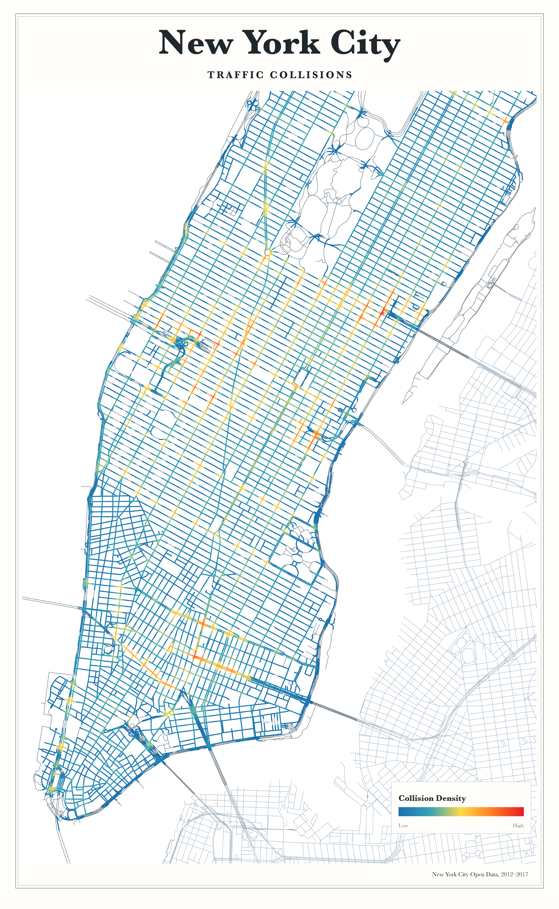

# New York City · Traffic Collisions

[Download the final full-resolution PNG](New-York-City-Traffic-Collisions-16x26.png). This is the selected **01 · Current composition**, with the logarithmic scale and approved Civic Atlas typography. The new standalone renderer reproduces its RGB pixels exactly; neither the poster layout nor the report was changed while packaging it.



## Construction

The poster pools **187,281 accepted Manhattan collisions** from NYC Open Data, **July 2012 through April 30, 2017**. The displayed `2012–2017` footer is an abbreviated date range: it does not imply complete first/last years. This is the historical reconstruction snapshot, not a 2017-only map. Gray roads in Queens and Brooklyn supply geographic context and do not represent analyzed collision observations.

1. Current NYS roads are projected to EPSG:26918, noded on a 1 m grid and divided into **50 m lixels**, with a shorter final piece where needed. Original line orientation determines the starting end; an 80 m edge becomes 50 m + 30 m. Geometry and IDs are frozen for comparisons.
2. Located collisions are assigned to the exact nearest lixel, with deterministic ID ties and acceptance within **100 m**. The frozen geometry, aggregate counts and reference field are in `data/poster-inputs.npz`. `export_inputs.py` can export them from the rebuilt `repro` schema.
3. The corrected spatial estimator sums assigned counts weighted by **Epanechnikov** kernel over shortest network distances between lixel midpoints. With `h = 100 m`, the contribution is `count × 0.75 × max(0, 1 − (distance/h)²) / h`. The spatial argument is actual network distance. Temporal corrections apply to the STNKDE report; this pooled spatial poster has no time-bin smoothing.
4. Positive densities use the original continuous blue–cyan–yellow–orange–red palette. The selected mapping is `log1p(density) / log1p(5.60221994929095)`, fixed to the approved composition's maximum. It preserves order while expanding visible differences at low/moderate values. Color is not proportional to raw collision counts or risk. The compact **Collision Density** legend deliberately uses Low/High rather than count labels.
5. Matplotlib draws opaque network strokes over muted contextual roads. The geographic extent is frozen in the render receipt. Baskerville Bold supplies the masthead and legend, with tracked capitals for **TRAFFIC COLLISIONS**; Baskerville Regular supplies the attribution. An ivory background, double hairline border and restrained footer complete the civic atlas composition.

The renderer checks source hashes and the geometry/radius fingerprint before computing values. Its default corrected field agrees with the stored analytical reference with **zero maximum absolute error**. The final PNG matches the regenerated image pixel for pixel; details are in [validation.json](validation.json).

## Render from the frozen bundle

Rendering needs no database. Use Python 3.13 and the pinned packages in `../reproduction/requirements.lock.txt`:

```sh
python3 -m venv .venv
.venv/bin/pip install -r reproduction/requirements.lock.txt
.venv/bin/python poster/render.py
```

Run these commands from the repository root. Output defaults to ignored `poster/generated/final.png` plus its JSON receipt. The renderer extracts locally installed macOS Baskerville faces into ignored `poster/.fonts/`. On other systems, supply licensed `Baskerville-Bold.ttf` and `Baskerville-Regular.ttf` with `--font-dir /path/to/fonts`. Font binaries are not redistributed. Different fonts or library versions can change rendered pixels.

Controlled alternatives keep the poster design constant:

```sh
.venv/bin/python poster/render.py --scale linear --output poster/generated/linear.png
.venv/bin/python poster/render.py --framing 05-bridge --output poster/generated/bridge.png
.venv/bin/python poster/render.py --kernel quartic --bandwidth 75 --output poster/generated/quartic-75.png
.venv/bin/python poster/render.py --year 2025 --framing 02-manhattan --output poster/generated/2025.png
.venv/bin/python poster/render.py --year 2026 --matched-period --framing 02-manhattan --output poster/generated/2026-matched.png
```

`--scale` supports full-range linear, the historical linear cap, a 95th-percentile cap, rank, power and log1p. Percentile/rank scales depend on visible positive lixels and are exploratory, not the selected final scale. The yearly log study calibrates one shared scale on all yearly fields; it never rescales each year independently.

## Comparison studies

| Study | Grid |
|---|---|
| Six color mappings, same layout and density | [Color scales](studies/poster-color-scales/comparison-grid-preview.jpg) |
| Six positions/zooms, same logarithmic scale | [Map framing](studies/poster-log-framing/comparison-grid-preview.jpg) |
| 2017–2025 full years and partial 2026 | [Annual grid](studies/poster-annual-2017-2026/annual-grid-preview.jpg) |
| Jan 1–June 11 in every year | [Matched-period grid](studies/poster-annual-2017-2026/same-period-grid-preview.jpg) |

The repository includes comparison-grid previews and study receipts, rather than every experimental full-resolution PNG. `session/` paths in historical receipts identify original session artifacts, not repository paths. The renderer can regenerate individual alternatives.

Annual source records, assignment counts, quality accounting and density arrays are bundled in `annual/data/`. The frozen source's latest observation was **June 11, 2026**; 2026 is partial and is never annualized. The main Queensboro investigation separately uses only complete years **2013–2025**. COVID, the April 2020 property-damage reporting change, missing coordinates and actual network changes confound comparisons.

## Printing

The final file is **4800 × 7800 pixels, 300 PPI, opaque RGB with an embedded sRGB profile**: exactly **16 × 26 inches**. Print at that size, preserve the whole composition and disable automatic cropping or color enhancement. Matte fine-art paper suits the fine lines and pale background. A border is already part of the artwork; any printer bleed/crop requirement needs a separately prepared export, not stretching this file.

The title is geographic; the analyzed observations are Manhattan-only. The network is a reconstructed, current, planar graph with no grade-separation or junction/terminal mass correction. Midpoint snapping approximates event position. The map is an unnormalized collision-concentration visualization, not a probability distribution, causal policy evaluation or exposure-adjusted risk estimate.
